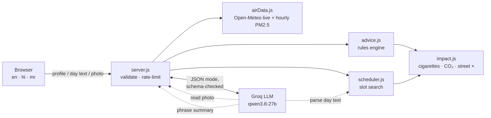

# SmogShift: smog-smart days for families

**PromptWars Virtual · Challenge 6 · Vertical: Urban Air Quality Assistant**

SmogShift turns live air-quality data into decisions a family can act on **today**, and explains
the impact of every choice in units people feel: **cigarettes of smoke avoided** and **kg of CO₂ saved**.
Available in **English, हिन्दी and मराठी**.

| Feature | What you do | What you get |
|---|---|---|
| **Today's plan** | Enter city + household (kids, elderly, asthma…, commute, heating fuel, purifier) | Ranked low-emission routines, indoor air hacks and sustainable alternatives, each with its impact, plus an AI summary |
| **Smog Scheduler** | Type your day in plain words: *"9am school drop, 11am market 1 hr, 6pm walk"* | Flexible outdoor tasks moved to the cleanest forecast hours, with a before → after cigarette count (e.g. 0.81 → 0.44 for a Delhi day) |
| **Photo Audit** | Photograph your kitchen or bedroom | AI vision spots indoor pollution sources (incense, unvented stove, damp…) with cheap fixes |
| **Street multiplier** | (automatic) | "You + 20 neighbours: 340 kg CO₂ saved per week", turning one household's choice into a community lever |

---

## Approach: numbers from code, words from AI

The core design rule: **every number and every decision is computed by tested, deterministic code.
The LLM only does what LLMs are good at**, which is reading messy human input and writing friendly text.



| Job | Done by | Why |
|---|---|---|
| Turn "9am school drop 20 min" into structured tasks | **Groq LLM** | Free text in 3 languages; rules can't parse that |
| Find visible pollution sources in a room photo | **Groq vision** | Needs image understanding |
| Write a warm 120-word summary in the user's language | **Groq LLM** | Language generation |
| AQI band, ranking actions, picking the cleanest hour, moving tasks, cigarette/CO₂ maths | **Plain code** | Must be correct, explainable, testable and identical on every run |

This means the model **cannot invent a number** that's shown as fact, every LLM output is validated
against a schema before use, and the app **still works without AI** (template summary; clear
"AI unavailable" message for the two AI-only features).

## How it works

### 1. Today's plan (`POST /api/plan`)
1. Validate the profile (enums + bounded numbers; city is the only free text).
2. Geocode the city and fetch current + hourly PM2.5 / US AQI from Open-Meteo (cached 10 min,
   concurrent requests share one fetch).
3. `advice.js` ranks actions with explicit rules, for example:

   | Context | Decision |
   |---|---|
   | AQI > 150, or AQI > 100 with asthma/heart/children/elderly/pregnancy at home, and someone exercises outdoors | **Move exercise indoors** (ranked first) |
   | Milder air, outdoor exerciser, a cleaner hour later today | Exercise at that hour |
   | AQI > 100 (or > 50 with sensitive members) | N95 outdoors |
   | Any later hour with lower PM2.5 | Shift errands there, *never* to a dirtier hour |
   | Car/motorbike commute | Switch to metro: weekly CO₂ + street multiplier |
   | Wood / coal / kerosene heating | Switch fuel (impact counted in households) |
   | Purifier owned / not owned | Run it overnight / build a ₹1,500 DIY box-fan filter |

   Every AQI > 50 plan contains at least one action from each required area: *low-emission routine*,
   *indoor air hack*, *sustainable alternative*.
4. Groq writes the summary from those facts only; the summary is length-checked, or replaced by a template.

### 2. Smog Scheduler (`POST /api/schedule`)
1. Groq extracts `{ name, start, durationMin, outdoor, flexible }` tasks (prompt-injection-hardened;
   output strictly validated, and one bad task rejects the list).
2. `scheduler.js` searches 30-minute slots, 06:00–21:00, from now on:
   only **flexible outdoor** tasks move, indoor/fixed tasks block their slot, no overlaps,
   a task moves only if exposure drops **≥ 10 %**, ties go to the earliest slot (deterministic).
3. Fixed outdoor tasks in unhealthy air (> 35.5 µg/m³) get an N95 tip.

### 3. Photo Audit (`POST /api/audit`)
1. The **browser** decodes the photo, auto-rotates, downscales to ≤ 1024 px and re-encodes it as JPEG.
   This strips EXIF/GPS metadata and cuts uploads to ~10–200 KB.
2. The server validates type and decoded size, sends it to Groq vision, and validates the findings
   (severity enum, ≤ 6 items, ≤ 200 chars each). **Photos are never stored or logged.**

## Gen AI usage

**Groq API** (OpenAI-compatible chat completions, JSON mode), model `qwen/qwen3.8-27b`
(one multilingual text + vision model; configurable with `GROQ_MODEL`). It's used in 3 places:
1. `src/prompts.js → tasksPrompt`: parse the user's free-text day into tasks (Smog Scheduler).
2. `src/prompts.js → auditPrompt`: find pollution sources in a room photo (Photo Audit).
3. `src/prompts.js → summaryPrompt`: write the plan summary in English, Hindi or Marathi.

The client is `src/llm.js`: 12 s timeout, per-call token budgets (400–600), typed errors. Groq rate
limits (HTTP 429) are passed on with `Retry-After`.

## Assumptions

| Assumption | Value | Source / reasoning |
|---|---|---|
| Cigarette equivalent | 22 µg/m³ PM2.5 for 24 h ≈ 1 cigarette | Berkeley Earth (Muller & Muller, 2015). An awareness metric, not a medical dose |
| Indoor share of outdoor PM2.5 | windows open 0.8 · closed 0.5 · HEPA purifier 0.2 | Conservative mid-range of published infiltration and portable-HEPA studies |
| N95 real-world filtration | 80 % (rated 95 %) | Allows for typical imperfect fit |
| CO₂ per passenger-km | car 0.17 · motorbike 0.11 · bus 0.10 · metro 0.035 · cycle/walk 0 kg | Typical urban averages (DEFRA / ICCT ranges) |
| Commute | round trip, 5 workdays/week | Typical office week |
| Outdoor time for errands | 2 h/day; exercise 1 h | Typical weekday |
| Sensitive-groups threshold for N95 tip | PM2.5 > 35.5 µg/m³ | US EPA breakpoint for "Unhealthy for sensitive groups" |
| Fuel swaps / open burning | Impact shown as households (you + 20 neighbours), not a number | No sourced per-household PM2.5 figure exists, so we don't invent one |
| Forecast | Open-Meteo hourly model data (CAMS) | Model output, not ground-station readings |

## Evaluation criteria → where to look

| Criterion | What we did |
|---|---|
| **Code quality** | Small pure modules (`impact`, `advice`, `scheduler`, `schemas`) with I/O at the edges (`airData`, `llm`, `server`); JSDoc on every export; named constants with sources; dependency injection so all I/O is testable; **zero runtime dependencies** |
| **Security** | All input validated at the boundary, **including LLM output**; API key server-side only; strict CSP (`default-src 'self'`, no inline script/style), `nosniff`, `frame-ancestors 'none'`, no-referrer; static allow-list (no path traversal); 8 KB body limit (photo route sized from the photo cap); per-IP rate limit; request timeout; `textContent`-only rendering (no `innerHTML`); prompt-injection-resistant prompts; photos never stored; errors never leak internals |
| **Efficiency** | No framework, no build step; static files gzipped and ETag-cached at startup (304 on repeat); 10-min air-data cache with in-flight de-duplication; air data and LLM called **in parallel**; images downscaled on-device; tight token budgets |
| **Testing** | 113 tests with the built-in `node:test` runner, fully offline (fake `fetch`, no API credits): unit tests for every rule and edge case, HTTP integration tests for every route and status code, i18n parity tests. **98 % line coverage** |
| **Accessibility** | Lighthouse Accessibility **100** (also Best Practices 100, SEO 100). Labels on every control, fieldsets/legends, skip link, visible focus, results in `aria-live` regions with focus moved to the result heading, errors in `role="alert"`, colour never the only signal (text category labels), `prefers-reduced-motion`, dark mode, 320 px layout, `<html lang>` switches with the language, 3 languages |
| **Problem alignment** | Low-emission routines ✔ indoor air hacks ✔ sustainable alternatives ✔ tailored to location (live city data) and lifestyle (household, commute, fuel) ✔ direct impact explained (cigarettes, CO₂, street multiplier) ✔ families (sensitive members) and communities (street multiplier) ✔ |

## Run it

Requires **Node.js ≥ 20**. No `npm install` needed: there are no dependencies.

```bash
cp .env.example .env          # add your free Groq key: https://console.groq.com/keys
npm run dev                   # http://localhost:3000 (auto-restarts on change)
npm test                      # 113 offline tests
npm run coverage              # coverage report
npm start                     # production start (used by Render)
```

Without `GROQ_API_KEY` the app still runs: plans use a template summary, and the scheduler and photo
audit say AI is unavailable.

### Deploy (Render)
New **Web Service** from this repo → Runtime *Node* → Build command *(empty)* → Start command
`npm start` → environment variable `GROQ_API_KEY`. Health check path: `/healthz`.
Note: Render's free tier sleeps when idle, so the first request after a sleep can take ~30 s.

## Project structure

```
server.js            HTTP entry: routes, rate limit, error handling, startup wiring
src/
  impact.js          cigarette-equivalent, exposure factors, commute CO₂, street multiplier (pure)
  advice.js          rules engine: air + profile → ranked actions (pure)
  scheduler.js       move flexible outdoor tasks into the cleanest free slots (pure)
  schemas.js         validators for all browser input and all LLM output
  prompts.js         the three Groq prompts + token budgets
  llm.js             Groq client (JSON mode, timeout, typed errors)
  airData.js         Open-Meteo geocoding + air quality, TTL cache
  http.js            security headers, JSON body parsing, gzip/ETag static files
  rateLimit.js       fixed-window per-IP limiter
  errors.js          user-safe typed errors
public/
  index.html  app.js  styles.css
  i18n/en.json hi.json mr.json
test/                one test file per module + server/static/i18n integration tests
SPEC.md              the spec this was built from
```

## Limitations

- Air data is a model forecast for the city centre, not a street-level sensor reading.
- Devanagari city names are only partly supported by the free geocoder (पुणे works; मुंबई doesn't),
  so English spelling is recommended in the form.
- In-memory cache and rate limiter are per-process, which suits a single instance.
- Health advice is general guidance, not medical advice.
